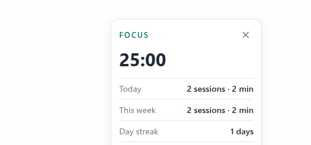

# Catalog submission — `plugin-catalog/hermes-focus-widget.yaml`

Adds one entry to the Hermes plugin catalog:

```yaml
name: hermes-focus-widget
repo: https://github.com/elianjuan-g/hermes-focus-widget
sha: "1b6bdcf7330539a69a23733a545dabe7025dcf37"
tier: community
```

## What the plugin does

A Pomodoro widget for Hermes Desktop that only counts focus time while the agent is actually working.

- **Agent-aware timer.** Focus 25 / short break 5 / long break 15 minutes after 4 focus sessions (all configurable). Hooks on `pre_llm_call`, `pre_tool_call`, `transform_llm_output`, `post_api_request` and `on_session_start` stamp agent activity; the focus timer only accumulates while the agent is active, waits automatically on agent idle, and resumes on the next activity. Manual mode (agent-awareness off) is a full classic wall-clock Pomodoro — first-class, not a fallback. Desktop chat turns execute in the Desktop's own `hermes serve` backend, a separate process from the gateway; both processes run this plugin and share one state file, so a stamp from either side reaches the widget within about a second (each hook persists the stamp immediately; each process folds the newest stamp in on every tick).
- **Three Desktop surfaces.** A draggable floating widget, a status-bar chip (`🍅 mm:ss` while focusing, `☕ mm:ss` on a break; click opens the page), and a full page (sidebar + command palette) embedding the loopback widget UI in a SandboxedFrame.
- **Session log + statistics.** Every focus session recorded (date, duration, completed/abandoned, mode); today / this week totals and a day streak. State in local JSON, written atomically, survives gateway restarts.
- **Slash command.** `/pomodoro start | pause | resume | stop | status | stats | reset`; the `focus_timer` tool exposes the same actions to the agent.
- **Zero setup, zero credentials.** No account, no API key, no extra install step, no CLI to install. Runs on Linux (and anywhere Hermes runs).

## Verification

- 69 unit + contract + persistence + end-to-end tests pass in the VM (`python3 -m unittest discover -s tests -t .`), including a scripted end-to-end scenario that proves agent-aware pause/resume with timer values (not label presence), a restart test proving state survives a gateway restart, and 5 tests proving activity stamps cross between the two plugin processes (gateway + Desktop serve backend) through the shared state file without ever regressing.
- `hermes plugins validate` green on Hermes 0.21.5 (PC): 14/14 checks. Live load verified through the real `PluginManager` (13/13, including a `post_api_request` invocation stamping activity in-process).
- Live on Hermes Desktop 0.21.5 (PC, 12 Nov 2026, scripted Playwright run against the packaged app): with a fresh activity stamp the focus timer counted 0 → 116 s and froze at 116 s once the stamp aged past the 120 s idle threshold, and the chip popover showed the live 23:04. The chip popover renders as a body portal (`position:fixed`, parent `BODY`) and is fully inside the viewport and readable (screenshot below). That stamp came from gateway-side activity.
- Honest gap: a scripted end-to-end Desktop chat turn has not completed in this environment — the Desktop composer unmounts during the landing-page settle faster than scripted input can reach it (8 probe runs: the send step fails, never the widget). The `post_api_request` hook and the cross-process sharing are implemented and verified in-process; the last link (a Desktop turn's own stamp) awaits a manual check — use the timer during a real chat and watch it count. Manual mode works fully in the meantime.
- `desktop/plugin.js` syntax-checked with `node --check`; imports only `@hermes/plugin-sdk` and `react/jsx-runtime`.

Chip popover, live Desktop render (cropped to the popover; full screenshots in the repo):



## Disclosure (rule 13)

- Network calls: none. The widget UI and its JSON API are served on loopback only (`127.0.0.1:18778` by default); the Desktop surfaces poll that endpoint (floating widget and status-bar chip every 2 s, full page every 1 s).
- Credentials: none read, none stored, none required.
- Reads outside the plugin's own data: none (the plugin only reads its own state file).
- Shell commands / long-running background processes: one daemon thread for the 1-second timer tick and one loopback HTTP server thread, both inside the gateway process; both stop with the gateway.
- Stored data: `~/.hermes/plugin-data/hermes-focus-widget/focus-state.json` (timer state, settings, session log). No telemetry leaves the machine.
- No self-updating code. Static `desktop/plugin.js`; updates reach users only through a SHA-bump PR here.
- Screenshots are real captures from a live Hermes Desktop render (Playwright on the operator PC), not mockups.

## Limits (stated in the README too)

- Agent activity is not human focus; the timer knows when the agent is working, not whether the operator is focused.
- It cannot see the operator typing outside Hermes; work in another app is invisible to it (use manual mode for that).
- Local installs only: if Desktop connects to a remote gateway, the floating widget and chip cannot reach the loopback server.
- One timer per gateway.
